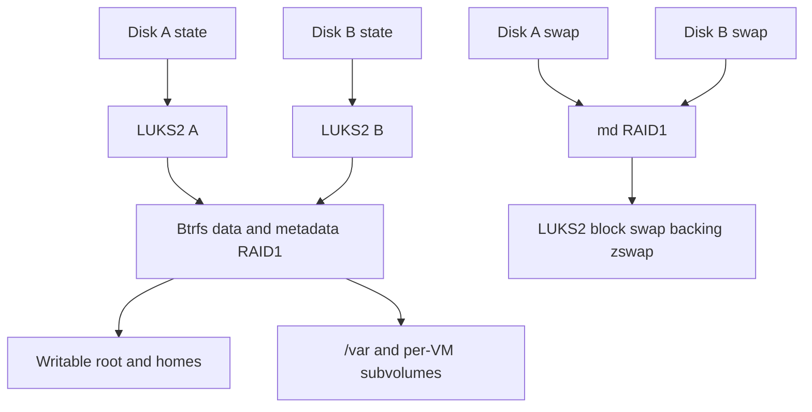

# Architecture and security decisions

ParticleVE separates verified host code, installation-specific authority, and
guest state. The split is an authority boundary, not merely a deployment detail.
ParticleOS supplies the image-based foundation; systemd owns boot, services,
networking, machine registration, and native VM launch. ParticleVE adds the
two-disk storage, update, recovery, and policy checks that those components do
not coordinate on their own.

The host is deliberately headless. Administration uses SSH, systemctl,
machinectl, and the journal. External configuration owns VM definitions,
resource allocations, networking attachments, and startup policy. The host
does not need a second management service to maintain a parallel VM inventory.

The Fedora 45 userspace and upstream stable systemd package family are combined
with Fedora's supported kernel packages, configuration, and patches. Kernel
updates follow the Fedora package repositories and the normal OBS image rebuild
path. Exact package identities and effective mitigations belong to each release's
provenance; see the [toolchain baseline](Toolchain.md) and
[build procedures](Build.md).

## Contents

- [Non-negotiable invariants](#non-negotiable-invariants)
- [Process and authority split](#process-and-authority-split)
- [Verified boot and independent loaders](#verified-boot-and-independent-loaders)
- [Encrypted storage and mirror admission](#encrypted-storage-and-mirror-admission)
- [Persistent startup configuration](#persistent-startup-configuration)
- [VM storage and identity](#vm-storage-and-identity)
- [VM lifecycle and confinement](#vm-lifecycle-and-confinement)
- [Network authority](#network-authority)
- [Authenticated time and maintenance](#authenticated-time-and-maintenance)
- [Crash-consistent update state](#crash-consistent-update-state)
- [Accounts and privileged administration](#accounts-and-privileged-administration)
- [External observations](#external-observations)
- [Native and dependency hardening](#native-and-dependency-hardening)
- [Verification](#verification)

## Non-negotiable invariants

1. Installation and replacement may erase only the explicitly reviewed disk
   identities, after confirmation of the exact plan.
2. A visible OS boot entry never references an incomplete artifact set. Both
   selected disks must hold the same verified release before automatic activation.
3. A new EFI loader never replaces the retained working loaders before its own
   execution and a healthy OS boot have been established.
4. Host executable code and security policy normally originate in verified
   `/usr`; writable settings do not gain unrestricted host-code authority.
5. OS fallback does not rewind writable root, administrator homes, guest disks,
   EFI variables, or virtual TPM identity.
6. A returning stale mirror member remains locked and outside assembly until
   the owner explicitly erases and rebuilds it from an admitted survivor.
7. An unclean writable session requires owner review of storage authority.
   Boot counting cannot decide which NOCOW replica is current.
8. Automatic OS maintenance never force-kills a VM. Ambiguous shutdown or
   restoration is preserved and reported.
9. Automatic activation starts only for an eligible update in the 04:30
   Europe/Berlin window; a missed window does not authorize a catch-up reboot.
10. Firmware installation, capsule staging, and firmware reboots remain
    supervised and exclude automatic OS work.
11. Each VM retains its own storage, cgroup ownership, SELinux category pair,
    persistent firmware state, and explicit resource limits.
12. Private image-signing keys remain outside deployed hosts and source control;
    independent owner recovery remains available without normal TPM unlock.

## Process and authority split

| Responsibility | Owner | Boundary |
| --- | --- | --- |
| Source selection, package recipes, image policy | Reviewed repository and OBS configuration | Source changes and dependency updates must preserve the declared build and state contracts. |
| Signing and publication | OBS signing/publication integration | Produces complete signed releases; deployed hosts receive public verification material. |
| Boot and service management | Firmware, systemd-boot, signed UKI, PID 1 | Secure Boot, verity, native boot assessment, and installed runtime guards precede guest access. |
| Two-disk installation and OS maintenance | ParticleVE coordinator and native tools | Explicit targets, authenticated inputs, durable transaction state, and shared exclusion lock. |
| Writable storage admission | Initrd admission code and firmware witness | Determines which encrypted members may be opened before Btrfs or swap discovery. |
| Host networking | networkd, resolved, chrony, nftables | Reviewed installation settings select interfaces, management access, DNS, and time sources. |
| VM definition and ordinary lifecycle | External privileged configuration | Supplies native units and data paths; must retain the host's launch and stop contract. |
| VM setup and execution | Native vmspawn, namespace brokers, QEMU/KVM | Trusted setup has narrow required authority; QEMU and auxiliary processes retain separate confinement. |
| Firmware installation | Owner and fwupd | Explicit supervised maintenance, device selection, and recovery. |
| Health delivery | Privileged inspector followed by an unprivileged sender | Network responses and the bearer credential are processed only after the irreversible privilege drop. |

The owner, authorized root administration, selected build/signing authorities,
firmware, and the host kernel are trusted. Guests, peer network traffic,
downloaded artifacts before verification, and external service responses are
untrusted. A writable guest disk is data; it is not an accepted source of host
executables or startup settings. An authorized configuration manager has
administrative authority and must be treated accordingly.

These controls constrain component compromise and detect policy drift. They do
not prove that an authorized administrator or compromised signing authority is
benign, that expected boot measurements exclude runtime compromise, or that a
working mirrored filesystem replaces external backups.

## Verified boot and independent loaders

Each selected disk has an independent ESP and two complete OS slots containing
EROFS `/usr` and its verification artifacts. A signed UKI binds the selected
kernel, initrd, and verified userspace. The writable root is mounted separately;
the visible `/usr` mount must itself be the read-only verified EROFS device.
Finding a verity mapper beneath a writable overlay is insufficient.

Two slots retain the running release and one other release. Preparation may
replace the inactive release; it does not provide simultaneous current,
previous, and next retention. Transfers use explicit installation targets and
protect the running version during native sysupdate cleanup.

The normal and removable-media EFI paths retain a loader that has completed a
healthy boot. New loaders are staged at hash-addressed paths and selected with
a create-only firmware entry plus BootNext. BootOrder remains unchanged.
Promotion requires agreement between BootCurrent, LoaderImageIdentifier,
booted ESP, actual file hash, host health, and native blessing. Reaching the OS
through the old loader quarantines the candidate instead of promoting it.
A loader that hangs before OS selection can require an owner reset; OS boot
counters cannot recover execution that never reaches them.

The initrd has a bounded boot deadline and independent recovery remains
available for longer repairs. Health assessment gates blessing and guest runtime
access. Failed releases are quarantined across the two ESPs without resetting
exhausted attempt counters. Application-level failures or an unavailable
external website do not trigger an OS rollback loop.

## Encrypted storage and mirror admission

State partitions are independently encrypted before participating in native
Btrfs RAID1. `/var` and `/var/lib/machines` are subvolumes; homes remain on the
encrypted writable root. Swap uses a separate md RAID1 device below LUKS2 and
block swap. Inherited zram defaults are disabled. Swap and zswap do not increase
the physical RAM available for capacity planning.

Normal unattended unlock uses PCR7 plus signed PCR11 authorization, without a
PIN or implicit pcrlock policy. Enrollment happens from a verified normal boot,
checks the written tokens, and retains independent recovery slots. A recovery
environment is never silently enrolled as an ordinary unattended boot.

Discard through encryption is an explicit installation decision and is not
enabled automatically. Record the selected policy and its storage/privacy
tradeoff during commissioning.

The nonvolatile `ParticleVEStorage` firmware witness binds the installation and
exact member identities. Firmware must support a durable, read-back-verifiable
variable of up to 4 KiB. Admission reads it before unlocking or scanning state
devices. Missing members are quarantined before degraded writes; returning
members remain cryptographically closed. Generic incremental Btrfs/md assembly
is disabled, and the state crypttab entries are `noauto`.

Each writable session sets an active marker. Late shutdown clears it only after
Btrfs is read-only, device errors are absent, and the same disk instances remain.
After an unclean session, owner recovery selects one previously admitted
authority with the installed filesystem unmounted. A missing or reset witness
cannot be reconstructed from whichever old disk appears first.

The monitor detects observed member-instance changes and device errors, records
quarantine, and fences the failed mapping. It cannot detect arbitrary silent
corruption, and detection has latency. The writable mirror can survive a member
failure, but losing the disk serving active `/usr` can interrupt operation and
require a reboot from the other boot path.

Disk readmission uses the explicit erasing replacement procedure, complete
foreground Btrfs copying, swap resynchronization, RAID1 profile verification,
and new boot-path/enrollment evidence. Scrub and apparently healthy profiles
alone never authorize a stale NOCOW replica. See
[encryption and admission](Operations.md#encryption-and-mirror-admission) and
[disk replacement](Operations.md#disk-replacement).

## Persistent startup configuration

Verified `/usr` owns host executables, libraries, Python modules, and policy.
Native system extensions, configuration extensions, and portable host-service
activation are masked. Persistent executable hooks, generators, loader inputs,
PAM/udev/polkit code, and local service executables must be absent, empty, or
links into verified `/usr`.

Regular local systemd files are limited to reviewed VM instance drop-ins and
the installer's named console drop-ins. The bounded inventory checks
descriptor-relative paths, metadata, and content hashes without following
writable links. It rejects other-account writes, ACLs, hard links, special files,
and host-code paths into writable state. Account databases and credentials have
their own metadata/authentication policy; their contents are not exported into
the code-origin digest.

Commissioning binds the approved inventory. The signed initrd checks it before
installed PID 1 interprets persistent settings. Deliberate changes require
maintenance, invalidation of the old approval, and new evidence. The retained OS
must enforce the same accepted contract. This is not a general offline detector
of root compromise, and `noexec` alone cannot establish code origin.

## VM storage and identity

External provisioning creates a private Btrfs subvolume per VM under
`/var/lib/machines`. Raw disk files receive NOCOW at creation time, before any
payload is written. Ordinary host files, EFI variables, and optional TPM state
retain normal CoW and checksums. NOCOW contents lose Btrfs data checksums and
compression; RAID1 and scrub cannot detect and repair silent corruption in those
contents by checksum comparison.

Each VM has a permanent unique pair of SELinux MCS categories. The root
subvolume and TPM directory use `virt_var_lib_t`; disks, seed media, and
precreated EFI state use `svirt_image_t`, with the same pair. The controller,
QEMU, swtpm, console descriptors, and temporary runtime state must agree on
ownership. Runtime helpers never recursively relabel retained guest storage.

TPM use is explicit. A VM either declares `--tpm=no` or uses a prepared private
directory with `--tpm=yes --tpm-state=PATH`. Native vmspawn reuses that identity;
the guard rejects implicit or transient state. New TPM provisioning uses the
reviewed image profile, which disables legacy SHA1 signature operations while
preserving the distinction between signatures and PCR hashing.

The signed persistent-state contract describes host state, mirror admission,
bootloader trials, Btrfs, VM unit/label interfaces, raw disks, EFI, and TPM state.
Exact RPM versions remain provenance. A compatible package-only update does
not require an arbitrary version-pair approval, but a changed stored interface
requires explicit review and retained-OS access evidence. Updates do not
automatically convert or rewind identities or data. See
[`Sources/particleve/contracts.py`](../Sources/particleve/contracts.py).

## VM lifecycle and confinement

The native `systemd-vmspawn@.service` template retains machined registration,
unit/cgroup ownership, namespace brokering, and readiness notifications. The
trusted launcher has only its reviewed setup capabilities. The QEMU handoff
clears all capability sets, supplementary groups, and the bounding set, sets
no-new-privileges, applies the native QEMU seccomp sandbox, and transitions to
the matching confined SELinux domain. Its UID remains subject to the root-owned
storage contract; dropping capabilities does not turn UID 0 into an
unprivileged user.

The supervisor remains the main process while native vmspawn owns the VM.
Ordinary stop requests use ACPI poweroff and wait for actual exits. Startup,
stop, and abort are not given an automatic final kill deadline, and final
SIGKILL is disabled. Automatic OS maintenance has a separate bounded refusal
and restoration transaction while the host is still running.

Every external VM definition supplies finite positive `MemoryHigh`, `MemoryMax`,
and `TasksMax`, with high below max. Limits cover the entire cgroup, including
QEMU, vmspawn, the supervisor, optional auxiliaries, page cache, and kernel
charges. A hard-limit OOM is deliberately fatal to the complete unit through
`OOMPolicy=kill` and `memory.oom.group=1`; it can lose uncommitted writes and is
never reported as graceful shutdown. External provisioning owns workload
budgets and restart policy.

## Network authority

Networkd owns physical NICs, management addressing, VLANs, and bridges.
Nftables applies the running image's policy to the installation's bound
settings. Management access is restricted to the reviewed network or VPN;
guest networking does not grant access to local management sockets or privileged
D-Bus operations. Local socket authorization is reviewed independently of
packet filtering.

Host-input filtering alone does not isolate guests sharing a bridge. External
network configuration owns forwarding policy, bridge filtering, and spoofing
controls for the selected guest segments. Review and exercise IPv4 and IPv6
separately, including guest access to management addresses and peer guests.

Resolved uses strict DNS-over-TLS with numeric endpoints and certificate names,
plus DNSSEC. Private routing domains and scoped negative anchors are explicit.
LLMNR and mDNS are disabled; failed private resolution does not authorize
plaintext transport or a public fallback. DNS transport authentication and
DNSSEC validation are separate controls.

SSH forwarding, tunnelling, X11, and agent forwarding are disabled. The signed
command line disables generated automatic SSH listeners. An authorized shell
can still run a network client; these restrictions remove unnecessary SSH
features rather than claim to contain the administrator.

## Authenticated time and maintenance

Chrony's restricted NTS client is the sole clock-synchronization owner. It runs
as chrony with only `CAP_SYS_TIME`, no UDP command listener, and encrypted
persistent state. Activation requires fresh authenticated agreement from
independent reviewed operators. It checks time before stopping VMs and again
before reboot, rejecting excessive steps or lost trust.

The dedicated activation timer starts at 04:30 Europe/Berlin with no persistent
catch-up. Readiness, mirror health, capacity, commissioning, firmware exclusion,
and the complete pending release are checked before touching guests. Starts
and restarts are temporarily inhibited, the actual VM/unit/process set is
reconciled, and ACPI poweroff is requested. Only confirmed exits permit reboot.

Failure cancels activation and restores only VMs stopped by that attempt,
including late exits. Previously stopped guests remain stopped. After a
successful reboot, external startup policy applies. If time or DNS cannot
bootstrap because the RTC is outside certificate validity, independent console
or numeric management access supports owner-verified clock recovery; the host
does not silently select unauthenticated time.

## Crash-consistent update state

Preparation, activation, persistent maintenance, replacement, and reconfiguration
share durable exclusion and explicit state. Completion flags are hints; actual
artifacts, identities, and health are rechecked before relying on them. An
interrupted transfer resumes the same authenticated release rather than mixing
versions from a moving feed.

An error after mutation begins does not prove the operation was rejected.
Interrupted VM restoration, storage replacement, loader promotion, and
configuration rebinding retain the evidence needed for their specific recovery
paths. No generic reset erases a journal to make a later check pass. Firmware
staging and BootNext remain preserved while OS work is inhibited.

## Accounts and privileged administration

Non-root human accounts use native systemd-homed subvolumes. SSH keys live in
the user record and are retrieved through userdb while the home is inactive.
Cold-home SSH requires a public key and the account password through PAM.
Root retains a separate recovery home and public-key route.

FIDO2 administration requires user presence and verification, with a separately
enrolled spare authenticator and independent recovery. Human credentials stay
separate from package-scoped build automation and installation-scoped report
submission credentials. The reviewed privilege inventory retains only the
required authentication helpers; native run0/polkit supplies elevation.

## External observations

The local inspector collects bounded host, storage, update, resource, and VM
confinement evidence. PID 1 allocates a private dynamic identity; native setpriv
irreversibly replaces the privileged inspector before any TLS response or
bearer credential is processed. The report crosses through a size-bounded,
sealed, non-executable memory file. The sender closes inherited descriptors
and applies its required filesystem restrictions before network delivery.

The receiver independently authenticates the installation, bounds the report,
and stores its own receipt time. Missing or stale reports must become visible
outside the host's trust domain. A report failure never stops a VM or requests
an unrelated reboot. Fresh receipt proves recent communication, not absence
of compromise. Optional boot attestation has a separate challenge/replay and
measurement contract; ordinary reporting is not attestation.

## Native and dependency hardening

SELinux, service capabilities, syscall and address-family policies, verified
code origin, module trust, memory privacy, and resource boundaries are reviewed
together. Privileged BPF and trusted namespace brokers remain available where
native systemd requires them. Kernel and userspace experiments require a
documented adoption or deferral decision; a benchmark is not permission to
silently preload an allocator or enable LoadPin globally.

See [hardening](Hardening.md) for effective settings, accepted limitations,
physical-interface decisions, trust rotation, and scoped historical evidence.
The build retains generic supported drivers and firmware rather than pruning
to the devices present on one OBS worker or installation.

## Verification

The [contributor requirements](../CONTRIBUTING.md#required-verification) define
checks for each change. Unit tests can establish intended rejection and
transaction behavior; they do not replace native boots, real access denials,
TPM/Secure Boot checks, device I/O, or recovery. Use
[release diagnostics](ReleaseDiagnostics.md) for repeatable release acceptance
and [commissioning](Commissioning.md) for the selected installation.

Historical results retain their source revision, image identity, fixture,
method, and limitations. They do not establish
that a later change or different machine passes. Workload provisioning and
backup systems remain external to this host platform.
